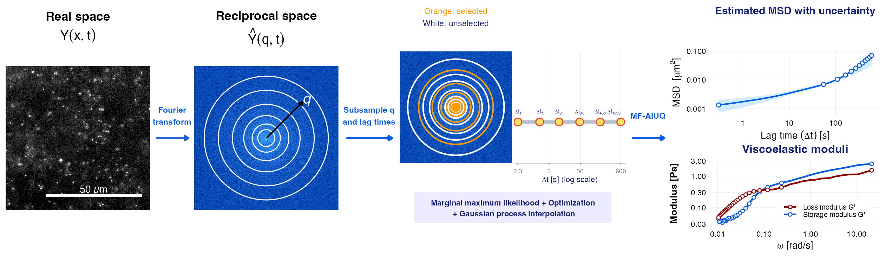

# MF-AIUQ: Model-Free *Ab Initio* Uncertainty Quantification in Scattering Analysis of Microscopy


[](https://www.r-project.org/)
[](https://cran.r-project.org/package=AIUQ)
[](https://arxiv.org/abs/2605.29424)

<p align="center">
  
</p>

## Reference

This repository provides the code used to reproduce the simulation and experimental results in:

Lin, T., Lee, J., Helgeson, M., Valentine, M. T., Luo, Y., & Gu, M. (2026). Model-free estimation in scattering analysis of microscopy. *arXiv:2605.29424*.

The article is available on [arXiv](https://arxiv.org/abs/2605.29424).

The code is prepared by Tong Lin and Mengyang Gu.

MF-AIUQ estimates the mean squared displacement (MSD) and its uncertainty directly from microscopy videos. 
The estimated MSD and confidence interval can be used to further compute the viscoelastic storage and loss moduli through the generalized
Stokes–Einstein relation. MF-AIUQ is implemented in the
[`AIUQ`](https://cran.r-project.org/package=AIUQ) R package.


## Overview

· [Installation](#installation)
· [Quick start](#quick-start)
· [Tutorial](docs/MF_AIUQ_examples.html)
· [Reproduce results](#reproducing-the-results)
· [Data](#data)
· [Citation](#citation)
· [Contact](#contact)


## Installation

First, install [R](https://cran.r-project.org/) and [RStudio](https://posit.co/download/rstudio-desktop/). 
R is the programming language used in this package, and RStudio is an integrated development environment (IDE) for running R code. The following installation commands are written in R and can be run in the RStudio Console.

Install the AIUQ package from CRAN:

```r
install.packages("AIUQ")
library(AIUQ)
```

The real data examples also use `bioimagetools` to read microscopy image
sequences: 

```r
install.packages("bioimagetools")
library(bioimagetools)
```

## Quick start

Run model-free MSD estimation on a microscopy intensity array:

```r
sam_mf <- SAM(intensity = intensity, intensity_str = "SST_array", mindt = frame_interval, pxsz = pixel_size,
              model_free_estimation = TRUE, uncertainty = TRUE
)
```

Estimate storage and loss moduli from the MSD and 95% confidence interval:

```r
moduli <- Get_Gp_Gpp_GSER(MSD_est = sam_mf@msd_est, d_input = sam_mf@d_input, MSD_lower = sam_mf@msd_lower, MSD_upper = sam_mf@msd_upper,
                          MSD_unit = MSD_unit, Temp = temperature, a = particle_radius
)
```

For detailed examples, see
[MF-AIUQ tutorial](docs/MF_AIUQ_examples.html).


## Reproducing the results

### Data

The microscopy datasets for experimental analysis are published on [Zenodo](https://doi.org/10.5281/zenodo.23116476). The simulation datasets are not included since they can be generated using the script provided below.

### Directory setup

Before running any script, please make sure that the R working directory is the `code/` folder of the downloaded repository.
After downloading the microscopy datasets, place the TIFF files directly in the `data/` folder of this repository. 

```r
# Check the current working directory using
getwd()
```
If necessary, replace the example path below with the location of the code/ folder on your computer:
```r
# macOS or Linux
setwd("/path/to/MF-AIUQ/code")

# Windows
# setwd("C:/path/to/MF-AIUQ/code")
```

The directory should be organized as follows:
```text
MF-AIUQ/
├── code/        ← R working directory
├── data/
│   ├── 4pct_PVA_1um_25C.tif
│   ├── 20mgmL_25C_DMSO_13min.tif
│   ├── snail_mucin.tif
│   └── ...
└── results/
```

### Simulation studies

[`simulation_implement.R`](code/simulation_implement.R) contains the simulation and MF-AIUQ implementation for the following scenarios:

- slow and fast Brownian motion;
- subdiffusive and superdiffusive fractional Brownian motion;
- Ornstein–Uhlenbeck motion; and
- a mixture of Ornstein–Uhlenbeck and fractional Brownian motion.

Select the desired scenario by following the comments in the script. 

The corresponding plotting script [`simulation_plot.R`](code/simulation_plot.R) reproduces the figures using the provided presaved records.

### Experimental analyses

After downloading the data from [Zenodo](https://doi.org/10.5281/zenodo.23116476), use the corresponding implementation script to run MF-AIUQ:

- [`real_eg_1_PVA_implement.R`](code/real_eg_1_PVA_implement.R) analyzes experiments on a 4% polyvinyl alcohol (PVA) solution using tracer particles of different sizes.
- [`real_eg_2_PEG_hydrogel_implement.R`](code/real_eg_2_PEG_hydrogel_implement.R) analyzes tetraPEG hydrogel experiments at six selected times, spanning the transition from early fluid-like behavior to increasingly constrained particle dynamics.
- [`real_eg_3_snail_mucin_implement.R`](code/real_eg_3_snail_mucin_implement.R) analyzes a snail mucin sample mixed with tracer particles.

The corresponding plotting scripts reproduce the figures using the provided presaved records:

- [`real_eg_1_PVA_plot.R`](code/real_eg_1_PVA_plot.R)
- [`real_eg_2_PEG_hydrogel_plot.R`](code/real_eg_2_PEG_hydrogel_plot.R)
- [`real_eg_3_snail_mucin_plot.R`](code/real_eg_3_snail_mucin_plot.R)
  
## Repository structure

```text
MF-AIUQ/
├── README.md
├── code/
│   │── simulation_implement.R
│   │── simulation_plot.R
│   │── real_eg_1_PVA_implement.R
│   ├── real_eg_1_PVA_plot.R
│   ├── real_eg_2_PEG_hydrogel_implement.R
│   ├── real_eg_2_PEG_hydrogel_plot.R
│   ├── real_eg_3_snail_mucin_implement.R
│   └── real_eg_3_snail_mucin_plot.R
├── data/
│   ├── example_video.tif
│   ├── 4pct_PVA_1um_25C_inset.tif
│   ├── 4pct_PVA_200nm_25C_inset.tif
│   ├── 4pct_PVA_100nm_25C_inset.tif
│   └── 4pct_PVA_100nm_25C_BF_inset.tif
├── results/
│   ├── DDM_UQ_records/
│   ├── MF_AIUQ_records/
│   ├── MPT_records/
│   └── GSER_records/
└── docs/
    ├── MF_AIUQ_examples.Rmd
    ├── MF_AIUQ_examples.html
    └── images/
        └── MF_AIUQ_workflow.png
```

## Citation

```bibtex
@article{lin2026model,
  title={Model-free estimation in scattering analysis of microscopy},
  author={Lin, Tong and Lee, Jinseok and Helgeson, Matt and Valentine, Megan T and Luo, Yimin and Gu, Mengyang},
  journal={arXiv preprint arXiv:2605.29424},
  year={2026}
}
```

## Contact

If you have any questions, please contact [tong_lin@ucsb.edu](mailto:tong_lin@ucsb.edu)


